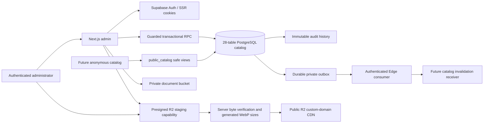
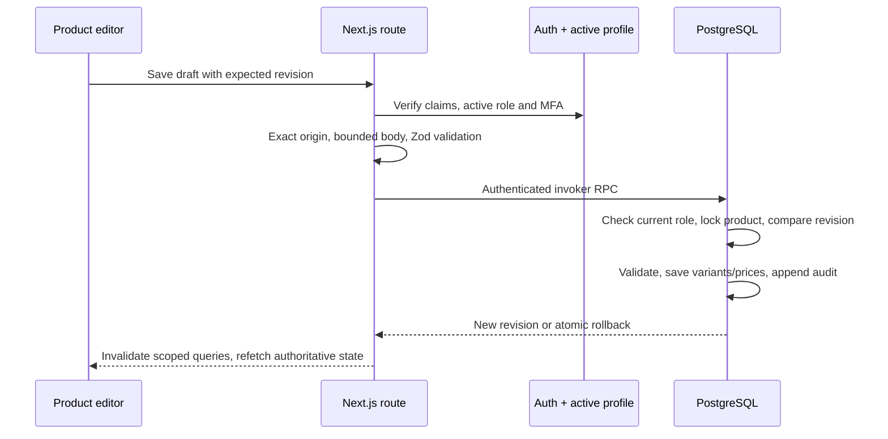

# System overview

Phase 1 is an independent Next.js admin application with Supabase PostgreSQL/Auth, Cloudflare R2 images and private Supabase document storage. Existing Cloudflare Images URLs are retained during migration. `apps/catalog` is contract-only. Reference applications are never runtime dependencies. Current storage trust boundaries are documented in [R2 lifecycle](r2-image-lifecycle.md).

Only the ordinary user token reaches catalog CRUD. Service role is isolated to verified provider operations and administrator invitations; those server endpoints first authorize the ordinary session. Private definer functions use fixed allowlists, fully qualified references and pinned search paths. Application roles cannot write aggregate tables directly. Master dictionaries permit admin INSERT/UPDATE under RLS; referenced masters have no hard-delete pathway.

Types are generated by read-only introspection of the applied isolated PostgreSQL schema (`scripts/introspect-types.mjs`), including actual FK metadata and function signatures. `pnpm db:types` supplies the official Supabase CLI path once Docker is available. Do not run the bootstrap SQL against Supabase: it provides local test doubles of platform-owned Auth/Storage objects only.
